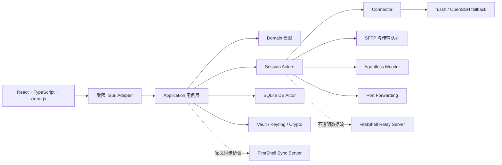

# 架构设计

## 目标与约束

FirstShell 的产品目标是将 SSH 终端、SFTP、主机监控、代理与隧道、代码片段、同步和远程桌面组织在一个高密度工作台中，同时保证凭据不进入持久前端状态、日志或普通业务 DTO，交互终端不被批量传输拖慢，核心能力可离线使用。

首期不追求插件市场、多人实时协作、浏览器版终端或兼容 FinalShell 私有存储格式。导入能力只能基于用户拥有且能够合法读取的数据格式单独设计。

## 总体架构



桌面端采用模块化单体。同步服务和中继服务是独立进程，只共享版本化协议 crate，不共享桌面端内部状态或数据库访问层。这使桌面端部署保持简单，同时避免远程服务获得本地凭据和明文配置。

## 仓库边界

建议工作区结构如下：

```text
apps/
  desktop/                 React 前端
  desktop/src-tauri/       Tauri 入口、命令与 capability
crates/
  domain/                  纯领域类型与不变量
  application/             用例编排、端口 trait
  session/                 会话 actor、状态机、资源调度
  ssh/                     SSH、SFTP、agentless 探针、代理、跳板与隧道
  storage/                 SQLite actor、迁移、备份
  security/                密钥、加密、known_hosts 与脱敏
  sync-protocol/           端到端密文同步协议
  relay-protocol/          中继认证、配额与数据帧
  relay-client/            直连优先、QUIC/TLS 与 TCP/TLS 回退
helpers/
  rdp/                     隔离 FreeRDP 子进程与认证 named-pipe IPC
services/
  syncd/                   可自托管同步服务
  relayd/                  可自托管加速与转发服务
docs/
  adr/                     架构决策记录
```

依赖方向必须保持单向：适配器依赖应用层，应用层依赖领域接口，基础设施实现接口。`domain` 不依赖 Tauri、SQLite、SSH 库或前端类型。详见 [ADR-0001](./adr/0001-modular-monolith.md)。

## 运行时模型

每个逻辑远程会话由一个 actor 管理，持有明确的公开状态机：`Connecting -> Authenticating -> Ready -> Disconnected/Reconnecting -> Closing -> Closed`。外部只能通过带类型的句柄提交命令，不能直接共享底层连接对象。

运行时遵循以下规则：

- 使用有界 `mpsc` 队列施加背压，禁止无界积压终端输出或传输事件。
- 每个长任务都绑定取消令牌、超时和父任务生命周期。
- 会话注册表只保存轻量句柄，不使用覆盖全局状态的大锁。
- 阻塞式密钥环、SQLite 和系统调用放入专用线程或受控阻塞池。
- 高频监控数据在 Rust 侧聚合和降采样，再推送给前端。
- 错误使用稳定代码、可安全展示的上下文和内部错误链，禁止把凭据写入错误文本。

M2 已将这些规则落实为 32 个会话的默认注册上限、256 条交互消息队列、64 KiB 单次输入上限和 30 秒连接超时。断开后的输入不会排队或重放，只有用户显式重连才会新建 transport。本地 PTY 由专用阻塞线程独占 master、writer 和 child，reader 在独立线程输出字节，避免在 Tokio worker 上同步等待或跨锁死锁。详见 [ADR-0005](./adr/0005-ssh-session-runtime.md) 和 [M2 验收记录](./verification/m2.md)。

### 双通道 SSH

一个逻辑会话至少区分两类传输通道：

| 通道 | 承载内容 | 调度目标 |
| --- | --- | --- |
| 交互通道 | Shell、窗口尺寸、心跳、小型控制消息 | 最低延迟，禁止被批量任务占满 |
| 批量通道 | SFTP、远程编辑、打包传输、大文件校验 | 高吞吐、可限速、可暂停 |

默认尽量复用连接；当服务器能力、窗口竞争或吞吐测试表明相互干扰时，允许为批量通道建立第二条 SSH 连接。连接数量有全局和单主机上限。详见 [ADR-0003](./adr/0003-dual-lane-ssh.md)。

## 连接体系

所有网络入口统一通过 `Connector`：

```text
Session -> Connector -> Direct | SOCKS5 | HTTP CONNECT | System Proxy | Relay | SSH Jump
```

Connector 负责 DNS 策略、连接超时、取消、代理认证、跳板链循环检测和审计标签。跳板链必须设置最大深度，系统代理解析后的结果会固化到本次连接上下文，避免运行中配置漂移。

M3 将 Connector 落在现有 `firstshell-ssh` crate 内：Direct、SOCKS5 和 HTTP CONNECT 共用一致的端点/超时边界，SOCKS5 支持本地或远端 DNS，HTTP CONNECT 与 SOCKS5 凭据只从 OS keyring 进入 Rust。Windows 系统代理读取当前静态配置，其他平台读取标准代理环境变量；每次连接只解析一次，不执行 PAC JavaScript。跳板链以首跳 Connector 加逐跳 `direct-tcpip` 组成，最多四跳，每跳独立认证和校验 host key。完整取舍见 [ADR-0006](./adr/0006-m3-operations-runtime.md)。

M6 在同一 Connector 增加 `Relay` 路由：先直接连接最终 SSH 目标，失败后尝试 QUIC/TLS，最后尝试 TCP/TLS。客户端只提交服务端定义的 mapping 名称，不提交任意目标；中继令牌从 OS keyring 直接进入 Rust 可清零值，TLS 只信任 profile 指定的 PEM/DER 证书。每次选择或失败以不含令牌的结构化事件输出。`relayd` 是独立二进制，仅依赖版本化协议、映射策略和配额，不链接 Vault、storage 或 SSH 凭据。完整取舍见 [ADR-0009](./adr/0009-m6-rdp-relay-runtime.md)。

SSH 默认使用纯 Rust `russh` 实现承载可控的终端、SFTP 和隧道能力。M2 的交互连接使用 20 秒 keepalive、连续 3 次失败阈值和 120 秒 inactivity timeout。平台 OpenSSH 只在用户明确启用且纯 Rust 路径返回连接类兼容错误时回退；认证失败、未知或变化的 host key 不得触发回退。桌面端回退目前只允许 agent 认证，并固定使用应用自有 known_hosts 和参数终止符，因此秘密不会进入 argv。

## 桌面 IPC 与状态所有权

Tauri command 用于低频请求/响应，例如连接配置 CRUD、解锁仓库和创建会话。Tauri channel/event 用于终端输出、传输进度和监控采样。只有实际基准证明高频二进制流达不到预算时，才考虑受鉴权的一次性 loopback transport，并以 ADR 记录。

Rust 是连接、传输、凭据和任务生命周期的唯一真相源。前端状态库只保存布局、选择、过滤器、临时表单和后端句柄，不复制远程会话状态机。

M2 通过 Tauri `Channel` 将公开状态、脱敏错误、host key 证据和终端输出推送到 xterm.js。密码、keyboard-interactive 响应、私钥口令和代理密码由统一的应用主题弹窗采集，只允许主窗口通过专用 IPC 提交，前端不把秘密写入全局状态、日志或普通业务 DTO，并在提交时立即清空表单状态。持久连接按认证类型写入隔离的 OS keyring 项；快速连接的秘密只随单次连接请求进入 Rust 的可清零容器。前端异步 session 生命周期以 generation 标识，开发模式重复挂载产生的迟到会话会立即关闭。

M3 的 `DesktopOperations` 独立持有 SFTP、传输、隧道和拖放暂存注册表。传输队列最多 256 项、全局同时执行 2 项；暂停按 `pausing -> paused -> queued/running` 收敛并保留安全 partial，取消使用独立的 `cancelling -> cancelled`，恢复/重试创建新 generation；公开快照携带非敏感 generation，使前端不会用迟到的旧回执覆盖新进度。Vault 锁定通过取消令牌清理全部运行资源。原生文件选择和系统拖放产生的绝对本地路径只存在于 Rust：WebView 仅收到一次性批次 ID、文件名、大小、远程相对路径和进度。拖放批次最多 8 个、每批 64 个常规文件、5 分钟过期并在消费后删除。

M3 补充的 companion coordinator 订阅每个持久化 SSH connection 的 ready pane 计数：首个 pane ready 后创建一个独立 SFTP workspace，同连接多分屏共享，最后一个 pane 退出后关闭。Operations 视觉折叠时组件仍挂载以维护生命周期；WebView 只保存 workspace ID 和公开快照，Rust 继续拥有认证、host key、以远端系统 `/` 为根的路径解析与关闭资源。自动 SFTP 失败与终端状态隔离。完整取舍见 [ADR-0007](./adr/0007-m3-companion-sftp-and-terminal-themes.md)。

M4 的 `DesktopTools` 独立持有最多 16 个周期监控，每个监控使用一条认证低优先级 SSH 连接和 300 点 `VecDeque`；事件只含版本化 sample、状态和稳定 diagnostic。Vault 锁定取消全部 monitor。session registry 的广播在持有注册表锁时先校验完整 target set 与队列容量，再统一入队；WebView 的 ready session ID 不赋予任意会话控制权。`DesktopOperations` 继续拥有远程编辑、压缩和 ZMODEM 生命周期，ZMODEM 复用 256 项/2 并发队列。完整取舍见 [ADR-0008](./adr/0008-m4-agentless-tools.md)。

M6 的 `DesktopRdp` 以 8 个 owned semaphore permit 限制并发 helper。桌面进程创建拒绝远程客户端的随机 named pipe，通过 helper stdin 传递一次性启动令牌，完成版本 2 握手后才发送单次 RDP 密码。helper 仅启动同目录的 `wfreerdp.exe`，唯一 argv 是 `/args-from:stdin`，连接参数和密码逐行写入 FreeRDP stdin；helper 退出、用户关闭、Vault 锁定或应用退出都会回收子进程。前端仅接收脱敏状态与错误，不接收密码、pipe 名或启动令牌。

Tauri capability 按窗口标签和命令最小授权；不暴露通用 shell、任意文件系统或任意 HTTP API。

## 主要 UI 信息架构

桌面端采用可调整的高密度工作台：

| 区域 | 默认职责 |
| --- | --- |
| 左侧栏 | 可收起的连接树、分组、标签、搜索和快速连接 |
| 中央工作区 | 多标签、多分屏终端和远程桌面 |
| 右侧栏 | 当前 SSH 主机状态、代码片段、命令历史和会话属性 |
| 底部面板 | SFTP 文件管理器、传输队列、问题与任务状态 |

面板可折叠、调整大小并保存工作区，但重要状态不能只靠颜色表达。左侧连接栏的展开状态与宽度一并写入加密 `ui_state`，旧布局缺少该字段时默认展开；折叠只改变展示，不关闭终端或后台任务。终端和文件传输在面板隐藏后仍继续运行，关闭会话时必须明确提示仍在运行的任务。

M2 中央工作区支持多标签和每标签最多四个独立分屏，分屏方向可按行或列切换；窄于 760 px 时列分屏自动改为纵向排列。每个 pane 独立管理 xterm、尺寸同步、host key 确认、重连与日志状态，终端模块动态加载以避免扩大主入口包。

M3 将底部面板扩展为独立动态加载的 Operations 工作区，包含 SFTP、远程文件操作、传输队列和本地/远程/动态隧道。补充布局将默认高度调为 260 logical px，并使用单行地址/操作栏、左侧懒加载目录树和右侧文件表；SFTP workspace 固定从远端系统 `/` 打开，实际访问由 SSH 账户的服务端权限决定，客户端继续拒绝 `..`、符号链接穿越和根目录变更。文件表、空白区、传输任务与隧道任务通过统一右键菜单复用现有动作。窄视口保持页面无横向溢出，Operations 与终端分别形成独立 chunk，避免扩大初始入口或终端模块。

M4 右侧栏通过“详情/工具”切换保留会话属性。持久 SSH 终端进入 Ready 后，应用自动复用既有 agentless monitor 管理器创建独立低优先级 SSH 连接；详情页直接展示 CPU、内存、SWAP、1 分钟负载、可切换网卡的收发速率和磁盘容量，终端断开或 Vault 锁定时停止对应监控。工具页只保留片段、历史和广播，默认打开片段；片段编辑与插入分离，广播的 target 与确认状态可见。底部 Operations 在同一 SFTP 工具栏加入远程文本编辑器、`.tar.gz` 打包和 ZMODEM。`ToolsWorkspace`、`OperationsWorkspace` 与 `TerminalWorkspace` 是三个独立 chunk，效率工具不会进入 xterm 包。

应用外观提供浅色、深色和跟随系统三态切换，使用语义颜色 token 保持两套配色下的层级、焦点与错误状态一致。该非敏感偏好由前端本地保存并可在 Vault 锁定页切换；终端配色仍由加密 terminal profile 独立管理。M3 补充提供 FirstShell、Solarized、Nord、Dracula、Gruvbox、One Dark、High Contrast 预设和完整自定义 ANSI palette，不能把应用外观主题误作终端主题。

## 文件、监控与远程桌面

M3 SFTP 工作区固定规范化远端系统 `/`，此后 API 路径仍使用根内相对表示；目录父链和目标使用 `lstat`/canonicalize 双重检查，符号链接只展示目标而不隐式跟随。客户端不再以登录用户目录作为访问边界，但不能绕过 SSH 账户的服务端权限。上传写入同目录 `.firstshell-part`，下载写入本地同目录 partial；取消或暂停保留安全 partial，恢复从已确认长度继续，可选大小或 SHA-256 校验。`russh-sftp 2.4` 未封装 OpenSSH `posix-rename` 扩展，因此新文件使用同目录 rename，覆盖既有文件时需先删除旧文件再 rename，存在极短替换窗口。M4 编辑器用两次 SHA-256 指纹检查阻止静默覆盖；压缩和 ZMODEM 也只接受规范化相对路径，状态与本地路径不持久化。

主机监控采用 agentless 固定模板读取 Linux `/proc`、`df`、`ps`、`ss`、`ping` 和 `traceroute`，输出 schema version 1 的 metrics/rows/diagnostic。host metrics 同时返回 CPU 累计计数、内存与 SWAP 字节数、1 分钟负载、各网卡累计字节和各挂载点容量；前端只基于相邻采样计算 CPU 占用与网速，不向远端注入动态命令。每次命令限时 8 秒、输出 512 KiB，表格与控制字符在 Rust 解析；连续三次失败进入 degraded，后续成功恢复。历史只在 Rust 保留 300 点，请求 1–300 点时按端点均匀降采样后进入 WebView。

RDP 由隔离的原生 helper 承载，通过带版本和认证的本地 IPC 与桌面端通信。helper 崩溃不能拖垮 SSH/SFTP 主进程，也不能读取仓库主密钥。

## 性能预算

M0 已冻结[参考硬件](../benchmarks/reference-hardware.json)、[固定数据集](../benchmarks/dataset.json)和[测量脚本](../scripts/run-m0-benchmarks.ps1)。初始目标如下，后续只能通过基准数据调整：

| 场景 | 初始预算 |
| --- | --- |
| Windows 冷启动到可交互 | 参考机 Release 构建小于 1.5 秒 |
| 普通 Tauri command | 本机 p95 小于 5 ms，不含真实网络耗时 |
| 并发工作负载 | 10 个活跃终端加 2 个文件传输时无输入丢失，终端延迟可观测 |
| SFTP 吞吐 | 同机同网条件达到 OpenSSH `sftp` 基线的 85% 以上 |
| 内存稳定性 | 8 小时会话压力测试无持续线性增长 |

性能结论必须来自 Release 构建、固定数据集和可重复脚本，不能用开发模式的体感替代。

M0 自动基线中，真实 Tauri channel 在 Rust 侧分发 10,000 个 1 KiB 交替终端/监控事件耗时 9.474 ms，且无事件丢失。完整环境、证据边界和后续待测项见 [M0 验收记录](./verification/m0.md)。

M3 Release 基准在同一受控 SSH/SFTP 服务上使用 64 MiB 上传加下载：Windows OpenSSH `sftp.exe` 为 2050 ms，产品路径为 821 ms，吞吐比 2.496；10 个终端与 2 个并行 64 MiB 上传时无输入丢失，p95 和最大终端响应均为 789 us。重放命令和环境见 [M3 验收记录](./verification/m3.md)。

## 失败隔离与可观测性

- 数据库写入、同步、传输、监控、RDP helper 和更新器分别拥有独立任务边界。
- 每个操作带关联 ID；日志默认脱敏，不记录终端输入正文。
- UI 对可恢复、需要用户操作和永久失败进行区分。
- 同步或中继不可用时，本地 SSH/SFTP 必须继续工作。
- 数据库迁移、仓库解锁或 host key 校验失败时采用 fail-closed，不静默降级。
