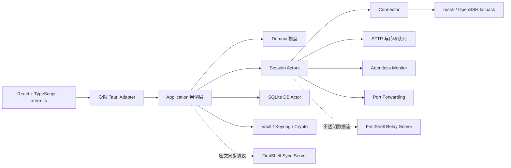

# 架构设计

## 目标与约束

FirstShell 的产品目标是将 SSH 终端、SFTP、主机监控、代理与隧道、代码片段、同步和远程桌面组织在一个高密度工作台中，同时保证凭据不进入 WebView、交互终端不被批量传输拖慢、核心能力可离线使用。

首期不追求插件市场、多人实时协作、浏览器版终端或兼容 FinalShell 私有存储格式。导入能力只能基于用户拥有且能够合法读取的数据格式单独设计。

## 总体架构



桌面端采用模块化单体。同步服务和中继服务是独立进程，只共享版本化协议 crate，不共享桌面端内部状态或数据库访问层。这使桌面端部署保持简单，同时避免远程服务获得本地凭据和明文配置。

## 仓库边界

建议工作区结构如下：

```text
apps/
  desktop/                 React 前端
  desktop/src-tauri/       Tauri 入口、命令与 capability
crates/
  domain/                  纯领域类型与不变量
  application/             用例编排、端口 trait
  session/                 会话 actor、状态机、资源调度
  ssh/                     SSH、SFTP、代理、跳板与隧道
  storage/                 SQLite actor、迁移、备份
  security/                密钥、加密、known_hosts 与脱敏
  sync-protocol/           端到端密文同步协议
  relay-protocol/          中继认证、配额与数据帧
services/
  syncd/                   可自托管同步服务
  relayd/                  可自托管加速与转发服务
docs/
  adr/                     架构决策记录
```

依赖方向必须保持单向：适配器依赖应用层，应用层依赖领域接口，基础设施实现接口。`domain` 不依赖 Tauri、SQLite、SSH 库或前端类型。详见 [ADR-0001](./adr/0001-modular-monolith.md)。

## 运行时模型

每个逻辑远程会话由一个 actor 管理，持有明确状态机：`Created -> Connecting -> Authenticating -> Ready -> Reconnecting/Closing -> Closed`。外部只能通过带类型的句柄提交命令，不能直接共享底层连接对象。

运行时遵循以下规则：

- 使用有界 `mpsc` 队列施加背压，禁止无界积压终端输出或传输事件。
- 每个长任务都绑定取消令牌、超时和父任务生命周期。
- 会话注册表只保存轻量句柄，不使用覆盖全局状态的大锁。
- 阻塞式密钥环、SQLite 和系统调用放入专用线程或受控阻塞池。
- 高频监控数据在 Rust 侧聚合和降采样，再推送给前端。
- 错误使用稳定代码、可安全展示的上下文和内部错误链，禁止把凭据写入错误文本。

### 双通道 SSH

一个逻辑会话至少区分两类传输通道：

| 通道 | 承载内容 | 调度目标 |
| --- | --- | --- |
| 交互通道 | Shell、窗口尺寸、心跳、小型控制消息 | 最低延迟，禁止被批量任务占满 |
| 批量通道 | SFTP、远程编辑、打包传输、大文件校验 | 高吞吐、可限速、可暂停 |

默认尽量复用连接；当服务器能力、窗口竞争或吞吐测试表明相互干扰时，允许为批量通道建立第二条 SSH 连接。连接数量有全局和单主机上限。详见 [ADR-0003](./adr/0003-dual-lane-ssh.md)。

## 连接体系

所有网络入口统一通过 `Connector`：

```text
Session -> Connector -> Direct | SOCKS5 | HTTP CONNECT | System Proxy | SSH Jump
```

Connector 负责 DNS 策略、连接超时、取消、代理认证、跳板链循环检测和审计标签。跳板链必须设置最大深度，系统代理解析后的结果会固化到本次连接上下文，避免运行中配置漂移。

SSH 默认使用纯 Rust 实现承载可控的终端、SFTP 和隧道能力；平台 OpenSSH 作为兼容回退，仅在用户明确启用且能力探测失败时使用。回退进程不得通过命令行参数接收秘密。

## 桌面 IPC 与状态所有权

Tauri command 用于低频请求/响应，例如连接配置 CRUD、解锁仓库和创建会话。Tauri channel/event 用于终端输出、传输进度和监控采样。只有实际基准证明高频二进制流达不到预算时，才考虑受鉴权的一次性 loopback transport，并以 ADR 记录。

Rust 是连接、传输、凭据和任务生命周期的唯一真相源。前端状态库只保存布局、选择、过滤器、临时表单和后端句柄，不复制远程会话状态机。

Tauri capability 按窗口标签和命令最小授权；不暴露通用 shell、任意文件系统或任意 HTTP API。

## 主要 UI 信息架构

桌面端采用可调整的高密度工作台：

| 区域 | 默认职责 |
| --- | --- |
| 左侧栏 | 连接树、分组、标签、搜索和快速连接 |
| 中央工作区 | 多标签、多分屏终端和远程桌面 |
| 右侧栏 | 主机监控、代码片段、命令历史和会话属性 |
| 底部面板 | SFTP 文件管理器、传输队列、问题与任务状态 |

面板可折叠、调整大小并保存工作区，但重要状态不能只靠颜色表达。终端和文件传输在面板隐藏后仍继续运行，关闭会话时必须明确提示仍在运行的任务。

## 文件、监控与远程桌面

SFTP 上传先写临时文件，再按目标能力执行原子重命名；覆盖、续传、符号链接和权限变化均需要明确策略。远程编辑保留原始版本指纹，保存时检测冲突。

主机监控首期采用 agentless 探针，优先读取 `/proc`、`/sys` 和稳定系统命令，输出版本化结构。探针必须有超时、输出上限和受控命令模板，禁止拼接未经验证的 shell 文本。

RDP 由隔离的原生 helper 承载，通过带版本和认证的本地 IPC 与桌面端通信。helper 崩溃不能拖垮 SSH/SFTP 主进程，也不能读取仓库主密钥。

## 性能预算

M0 已冻结[参考硬件](../benchmarks/reference-hardware.json)、[固定数据集](../benchmarks/dataset.json)和[测量脚本](../scripts/run-m0-benchmarks.ps1)。初始目标如下，后续只能通过基准数据调整：

| 场景 | 初始预算 |
| --- | --- |
| Windows 冷启动到可交互 | 参考机 Release 构建小于 1.5 秒 |
| 普通 Tauri command | 本机 p95 小于 5 ms，不含真实网络耗时 |
| 并发工作负载 | 10 个活跃终端加 2 个文件传输时无输入丢失，终端延迟可观测 |
| SFTP 吞吐 | 同机同网条件达到 OpenSSH `sftp` 基线的 85% 以上 |
| 内存稳定性 | 8 小时会话压力测试无持续线性增长 |

性能结论必须来自 Release 构建、固定数据集和可重复脚本，不能用开发模式的体感替代。

M0 自动基线中，真实 Tauri channel 在 Rust 侧分发 10,000 个 1 KiB 交替终端/监控事件耗时 9.474 ms，且无事件丢失。完整环境、证据边界和后续待测项见 [M0 验收记录](./verification/m0.md)。

## 失败隔离与可观测性

- 数据库写入、同步、传输、监控、RDP helper 和更新器分别拥有独立任务边界。
- 每个操作带关联 ID；日志默认脱敏，不记录终端输入正文。
- UI 对可恢复、需要用户操作和永久失败进行区分。
- 同步或中继不可用时，本地 SSH/SFTP 必须继续工作。
- 数据库迁移、仓库解锁或 host key 校验失败时采用 fail-closed，不静默降级。
