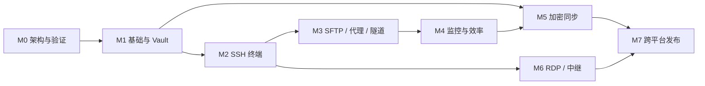

# 同步里程碑

本文件是项目进度的唯一真相源。功能矩阵描述范围，本文描述依赖、交付件和完成门槛。没有经过验收的功能不得仅因“代码已合并”而标记完成。

## 状态规则

| 状态 | 使用条件 |
| --- | --- |
| Not started | 前置条件未满足或尚未进入实现 |
| In progress | 已开始设计、验证或实现，但退出门槛未满足 |
| Blocked | 有明确外部阻塞，必须记录负责人和解除条件 |
| Deferred | 项目负责人明确暂缓，恢复前不得进入设计、验证或实现流程 |
| Complete | 所有交付件、测试、安全、性能和文档门槛均满足 |

## 总览

| 里程碑 | 目标 | 依赖 | 当前状态 |
| --- | --- | --- | --- |
| M0 | 架构冻结与关键技术验证 | 无 | Complete |
| M1 | 桌面骨架、数据层与安全仓库 | M0 | Complete |
| M2 | 可日常使用的 SSH 终端 | M1 | Complete |
| M3 | SFTP、代理、跳板与隧道 | M2 | Complete |
| M4 | 主机监控与效率工具 | M3 | Complete |
| M5 | 端到端加密同步 | M1；全量集成依赖 M4 | Deferred |
| M6 | RDP 与自托管加速中继 | M2 | In progress |
| M7 | 跨平台、发布与稳定性 | M2-M6 | Not started |

项目负责人于 2026-08-24 决定暂缓 M5；在负责人明确恢复前，M5 不进入设计、验证或实现流程，也不作为默认下一开发阶段。M6 可独立排期，但不能扩大 SSH 核心的权限边界。

## M0 架构冻结与关键技术验证

目标：用可运行 spike 消除 Rust/Tauri、SSH、IPC、SQLite 加密和平台能力上的高风险假设，并冻结首个实现基线。

交付清单：

- [x] 架构、安全、数据模型、功能矩阵、里程碑和关键 ADR。
- [x] `russh` 终端、认证、host key 与 SFTP 双通道 spike。
- [x] Tauri channel 在终端输出和监控采样下的吞吐与延迟基准。
- [x] SQLite DB actor、OS keyring、记录加密和损坏恢复 spike。
- [x] Windows RDP helper 选型与最小 IPC 隔离验证。
- [x] ZMODEM、RDP、终端、SSH 和加密依赖的许可证审查。
- [x] 固定 Windows 参考硬件、测试数据集和性能测量脚本。
- [x] 创建 Rust workspace、Tauri 应用骨架、AGPL-3.0 LICENSE 与基础 CI。

验收证据：[M0 验收记录](./verification/m0.md)。

退出门槛：关键 spike 无阻塞性缺口；性能预算可测量；依赖许可证兼容；设计文档经人工确认；后续如改变核心边界必须新增 ADR。

## M1 桌面骨架、数据层与安全仓库

目标：交付可安装、可解锁、可管理连接配置的 Windows 桌面骨架，为所有后续能力提供稳定边界。

主要交付：

- [x] Tauri capability、CSP、typed command/channel 和统一错误模型。
- [x] SQLite DB actor、版本化迁移、完整性检查和 online backup。
- [x] OS keyring、恢复口令 key slot、Vault Key、记录级 XChaCha20-Poly1305 加密、自动锁定。
- [x] 连接、文件夹、代理引用、终端配置的 CRUD、revision 约束、软删除撤销和内存搜索索引。
- [x] 顶栏服务器二级页、中央标签区、左侧详情/工具与底部可调整面板骨架，以及浅色/深色/系统应用主题。
- [x] 独立口令加密导出、验证导入、恢复前 online backup 和事务替换流程。

退出门槛：冷启动与 IPC 达到预算；锁定态不泄露敏感字段；迁移失败可恢复；关键 Tauri 越权测试、密码学测试和 UI 键盘可达性通过。

验收证据：[M1 验收记录](./verification/m1.md)。M1 已完成自动化门禁、release EXE 与 NSIS 安装包构建；安装后人工交互、视觉截图与完整冷启动验收原计划在 M4 后执行，但项目负责人于 2026-08-24 决定跳过本轮实机测试，延期项仍未通过并移入 M7。

## M2 可日常使用的 SSH 终端

目标：让用户可以安全、稳定地完成多会话 SSH 日常工作。

主要交付：

- [x] 密码、公钥、keyboard-interactive 和可用平台的 SSH agent 认证。
- [x] known_hosts、TOFU、密钥变化阻断和按主机弱算法例外。
- [x] xterm.js 终端、多标签、多分屏、窗口尺寸同步、保活和显式重连。
- [x] 会话 actor、交互通道、取消、超时、资源上限和错误诊断。
- [x] 本地终端、终端主题/字体/键位/编码，以及显式会话日志。
- [x] 纯 Rust SSH 主路径和受限、可诊断的 OpenSSH 兼容回退。

退出门槛：10 个并发活跃终端压力测试无输入丢失；恶意 banner、连接中断、host key 变化和认证失败测试通过；秘密未进入前端持久状态、普通业务 DTO、argv 或日志。

验收证据：[M2 验收记录](./verification/m2.md)。agent 认证在平台 agent 可用时启用；本次完成实现、编译门禁与失败边界审查，不伪造本机未运行的 agent 服务，实机成功认证边界在验收记录中单列。

## M3 SFTP、代理、跳板与隧道

目标：补齐远程文件和复杂网络环境下的核心运维工作流，同时保护交互终端延迟。

主要交付：

- [x] 同工作区 SFTP 浏览器、双通道调度和有界传输队列。
- [x] 上传、下载、暂停、取消、重试、续传、临时文件、能力受限的安全替换和可选校验。
- [x] 文件新建、重命名、删除、权限和明确的符号链接策略。
- [x] Direct、SOCKS5、HTTP CONNECT、系统代理和 SSH 跳板链 Connector。
- [x] 本地、远程、动态端口转发，监听范围和暴露风险提示。

退出门槛：SFTP 达到 OpenSSH 基线 85% 以上；大文件传输不破坏终端交互预算；路径穿越、跳板循环、代理认证、断点恢复和端口暴露测试通过。

验收证据：[M3 验收记录](./verification/m3.md)。Release 基准在同一受控 SSH/SFTP 服务上以 Windows OpenSSH `sftp.exe` 为基线；系统代理按连接固化静态结果，PAC JavaScript 不在 M3 边界内。

### M3 补充：终端伴随文件工作流与启动体验

- [x] 持久化 SSH 终端 Ready 后自动建立 companion SFTP，同连接多 pane 共享，最后一个 pane 退出后回收；SFTP 故障不影响终端。
- [x] SFTP 从远端系统 `/` 打开，使用紧凑单行工具栏、顶部地址栏、左侧懒加载目录树、右侧文件表和上下文菜单，并在前端与 Rust 两层拒绝 `..` 与符号链接穿越。
- [x] 应用启动优先使用设备 OS keyring 解锁 Vault，失败时回落到恢复口令。
- [x] 终端提供 FirstShell、Solarized、Nord、Dracula、Gruvbox、One Dark、High Contrast 预设及完整自定义 ANSI palette；旧 profile 保持 schema 2 兼容。
- [x] 双视口视觉基线、Rust/前端测试、生产构建、Clippy、许可证扫描和公告扫描通过。

补充验收证据：[M3 补充验收记录](./verification/m3-supplement.md)。Gruvbox 仅按项目负责人决定作为开发阶段许可证例外保留，M7 发布前必须取得明确授权或移除；该例外不等于许可证审查通过。

## M4 主机监控与效率工具

目标：在不安装远端 agent 的前提下提供低开销观测和可控的命令效率能力。

主要交付：

- [x] SSH Ready 后自动启动详情监控，展示 CPU、内存、SWAP、负载、可切换网卡的网速与磁盘容量。
- [x] 监控降采样、环形缓冲和异常状态；周期监控只在详情页自动呈现，工具页不提供监控或诊断入口。
- [x] 加密代码片段、类型化参数、标签、搜索和默认只插入终端。
- [x] 命令历史、路径历史、补全和带明确目标选择的命令广播。
- [x] 带冲突检测的远程编辑、受控压缩传输和许可证合规的 ZMODEM。

退出门槛：监控不阻塞终端、探针资源受限、广播有紧急停止；远端恶意输出、片段注入、编辑冲突和长期内存稳定性测试通过。

验收证据：[M4 验收记录](./verification/m4.md)。自动化覆盖独立监控连接、有界环形缓冲、探针注入、片段渲染、原子广播、编辑冲突和 ZMODEM 状态机；项目负责人于 2026-08-24 决定跳过安装后人工交互、真实远端 SSH/SFTP、真实 lrzsz、多显示器和人工窗口验收，将其明确延期到 M7。M4 `Complete` 不等于这些延期项已通过。

## M5 端到端加密同步

状态：**Deferred**。项目负责人于 2026-08-24 决定暂不进入开发流程；以下内容仅保留为既有范围草案，不代表已启动设计或实现。恢复开发必须先由项目负责人确认，并在同一变更中把总览与功能矩阵状态改回 `Not started` 或 `In progress`。

目标：让用户通过自托管服务安全同步工作区配置，而服务端无法读取内容。

主要交付：

- 版本化 sync protocol、自托管 `syncd`、认证、配额和部署文档。
- Argon2id Sync Key、对象认证加密、设备密钥、注册、撤销和轮换。
- 离线 outbox、增量拉取、ETag、tombstone 和重放防护。
- 连接、代理、终端配置、片段、历史策略和 UI 布局的分类型同步。
- 高风险对象人工冲突解决及低风险对象明确的合并策略。

退出门槛：被完全读取或篡改的服务端不能恢复明文或伪造有效对象；离线、多设备并发、撤销、轮换、回放和灾难恢复测试通过；自托管升级保留数据。

## M6 RDP 与自托管加速中继

目标：在不污染 SSH 核心信任边界的情况下补充远程桌面和受控网络中继。

主要交付：

- [x] Windows RDP helper、版本化认证 IPC、伴随窗口、嵌入模式协议和显式重连。
- [x] 自托管 `relayd`、QUIC/TLS 主路径、TCP/TLS 回退和直连优先选择器。
- [x] 中继身份认证、服务端目标映射、带宽/时长/并发配额和结构化审计。
- [x] RDP 密码与中继令牌使用独立 OS keyring 项；helper、FreeRDP 与 relay 均不能获得 Vault Key。
- [ ] 随安装产物提供审查后的 FreeRDP 二进制，并通过真实 RDP 服务、窗口/DPI 与崩溃恢复验收。
- [ ] 在可用 UDP 环境通过真实 QUIC/TLS 互操作、降级、长时资源与恶意配额边界验收。

退出门槛：helper 崩溃不影响 SSH/SFTP；IPC 劫持、未授权目标、配额绕过、协议降级和资源耗尽测试通过；直连优先和回退行为可观测。

当前证据：[M6 验收记录](./verification/m6.md)。实现和本地自动化已覆盖 helper 认证、协议注入拒绝、目标策略、并发配额、直连优先及真实 TCP/TLS 回退；本机没有可分发的 `wfreerdp.exe`，且 Windows 本地 QUIC 测试尚未完成握手，因此 M6 保持 `In progress`，不得标记为 `Complete`。

## M7 跨平台、发布与稳定性

目标：形成可重复发布、可安全升级并支持 Windows、macOS、Linux 的稳定版本。

主要交付：

- Windows 安装包、签名更新、回滚和卸载数据策略。
- macOS keychain、签名、公证及平台终端/RDP 替代能力说明。
- Linux Secret Service、Wayland/X11 和目标发行格式支持。
- 全 schema 升级矩阵、长时压力、网络故障注入和恢复演练。
- SBOM、依赖与许可证门禁、发布清单、运维和安全响应文档。

退出门槛：三平台核心 SSH/SFTP/同步流程通过；签名升级与回滚可验证；8 小时压力测试无持续线性内存增长；无未处置高危安全问题。

## 同步更新契约

每次里程碑状态变化必须在同一个变更中完成以下同步：

1. 更新本文总览状态和对应交付清单，不提前勾选仅有草稿或未验证的项目。
2. 更新 [功能矩阵](./feature-matrix.md) 中受影响能力的状态与目标。
3. 更新架构、安全、数据模型或新增 ADR，记录实现偏离和原因。
4. 附上可重复的测试、性能和安全验证证据；无法本地执行的检查必须明确标记。
5. 若改变 schema 或协议，更新迁移、兼容窗口和回滚说明。
6. 若改变主要 UI 信息架构，同步更新布局说明与验收截图基线。

里程碑验收建议使用独立变更进行，完成后再开始依赖它的里程碑。任何临时实现都必须有明确 TODO、移除条件和负责人，不能成为长期架构的隐式依赖。
