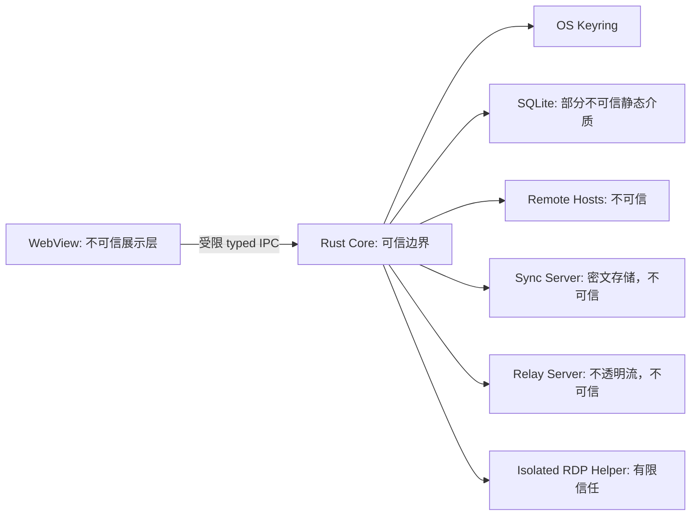

# 安全设计

## 威胁模型

需要保护的核心资产包括服务器凭据、私钥及口令、主机地址与用户名、代理配置、命令历史、代码片段、同步密文元数据和用户终端内容。

主要威胁包括：恶意网页或 WebView 注入、被攻陷的同步/中继服务、同机低权限进程读取文件、供应链依赖投毒、网络中间人、恶意或已失陷的远端主机、路径穿越和不安全更新。

已完全控制用户操作系统或能够读取当前进程内存的攻击者不在可彻底防御范围内，但设计仍应缩短明文驻留时间、隔离 helper、限制 IPC 和避免持久化敏感日志。

## 信任边界

WebView 永远不接收私钥、密码、仓库主密钥或同步口令。服务端默认被视为可能泄露、篡改或回放数据，客户端必须验证真实性和版本。

## 本地密钥体系

首次初始化时生成 32 字节随机 Vault Key。用户必须设置至少 12 字节的恢复口令；客户端以 Argon2id 派生的恢复密钥和 XChaCha20-Poly1305 包装 Vault Key，将版本化恢复 slot 保存在 SQLite。操作系统密钥环保存同一 Vault Key，作为日常快速解锁路径；密钥环丢失时，正确的恢复口令可以解包 Vault Key 并重新登记到密钥环。SQLite 不保存可直接解密的主密钥。

每条敏感记录使用 HKDF 从 Vault Key 派生记录子密钥，派生上下文包含实体类型、稳定 ID、schema 版本和密钥版本。数据使用 XChaCha20-Poly1305 加密，每次写入生成唯一随机 nonce；表名、记录 ID、schema 版本和 revision 进入 AAD，防止密文跨记录替换。

| 密钥 | 来源 | 用途 | 持久化方式 |
| --- | --- | --- | --- |
| Vault Key | CSPRNG 随机生成 | 本地记录加密根密钥 | OS keyring；另有恢复口令加密的副本 |
| Record Key | HKDF 派生 | 单条记录加解密 | 不持久化 |
| Recovery Key | 用户恢复口令经 Argon2id 派生 | 包装和恢复 Vault Key | 不持久化，参数、salt、nonce 和密文 slot 进入 SQLite |
| Sync Key | 用户同步口令经 Argon2id 派生 | 端到端同步封装 | 默认不持久化，可由 Vault Key 包装缓存 |
| Export Key | 导出口令经 Argon2id 派生 | 加密备份包 | 不持久化 |

M1 的恢复与导出容器使用 Argon2id v1.3，当前参数为 64 MiB、3 次迭代、1 lane，并将参数与密文一起版本化；解密端拒绝超出安全范围或未知版本的参数。解锁态 Vault Key、派生密钥、恢复口令和导出口令使用可清零容器，锁定、退出和身份切换时主动清除；不承诺编译器和操作系统层面的绝对零残留。

## 数据分级

SQLite 明文字段只保留数据库运行所需的稳定 ID、外键、版本、时间戳、删除标记和非敏感枚举。主机名、地址、用户名、代理目标、私钥引用、历史命令、代码片段和远程路径进入加密 payload。

为了避免在密文上伪造低质量查询，解锁后在内存建立有限搜索索引；锁定时销毁。默认不把终端正文和监控原始采样持久化。

详细表结构见 [数据模型](./data-model.md) 和 [ADR-0002](./adr/0002-sqlite-encrypted-records.md)。

## SSH 安全策略

- 默认严格校验 host key。首次连接通过明确的 TOFU 对话展示算法和指纹。
- 已知主机密钥变化时阻止连接，用户必须查看旧/新指纹并显式处理。
- 优先现代 KEX、主机密钥、密码学和 MAC；弱算法只能按单主机临时启用并显示风险。
- 密码、私钥口令和 keyboard-interactive 响应只在 Rust 侧短期存在。
- SSH agent 转发、远程端口转发和动态代理默认关闭。
- 跳板链逐跳执行 host key 校验，并限制深度、循环、超时和目标范围。
- OpenSSH 回退不得把秘密写入命令行、环境变量、临时明文文件或日志。
- 会话日志必须显式开启。M2 只记录远端输出，不记录用户键盘输入，文件位于应用数据目录并按 7 天清理；远端主动回显或用户主动显示的秘密仍可能进入日志，因此启用前必须展示风险。

M2 的默认 `russh` 路径从算法列表移除 SHA-1 `ssh-rsa`，旧 KEX/cipher/MAC 只能随单主机配置追加且保持最低优先级。首次连接写入应用自有 OpenSSH 格式 known_hosts 前必须展示 SHA-256 指纹；密钥变化始终 fail-closed。OpenSSH 回退仅处理连接类失败，不能绕过认证或 host key 错误，桌面入口当前只允许 agent 模式并使用固定参数构建。

密码、keyboard-interactive 响应和私钥口令由原生 Rust 对话框取得，最大 4096 字节；WebView 只查询凭据是否已配置。keyring 状态检查读取到的明文会立即清零，认证枚举的 `Debug` 输出固定脱敏。keyboard-interactive 最多响应 8 轮且拒绝要求回显的提示。Windows 优先连接 OpenSSH agent named pipe，再探测 Pageant；没有可用 agent 或身份全部被拒绝时返回稳定脱敏错误，SSH agent forwarding 仍默认关闭。

M3 的 SOCKS5/HTTP CONNECT 代理密码采用独立 keyring 项，协议错误只返回稳定认证/连接状态，不回显认证头。系统代理只在连接开始时解析静态配置，防止运行中漂移；PAC JavaScript 未引入当前信任边界。跳板链最多四跳，应用层拒绝直接、重复和传递循环，每跳 host/port/指纹绑定审批证据。配置代理或跳板时禁止 OpenSSH 回退，避免绕过所选路由或逐跳信任策略。

本地、远程和动态隧道默认绑定 loopback；任何非 loopback bind 都必须携带 UI 的显式暴露确认。动态隧道只实现有界的 SOCKS5 CONNECT/no-auth，本地监听本身不提供认证，因此不得在未确认时暴露到局域网或公网。每个隧道最多 128 个并发转发连接，关闭时取消 listener、断开 SSH 链；远程转发还显式撤销服务器侧 bind。

## Tauri 与前端

- 只加载随应用打包的本地资源，生产构建禁止远程脚本。
- 配置严格 CSP，禁用不需要的导航、窗口创建和外部协议。
- capability 按窗口标签授权；命令参数在 Rust 边界进行长度、格式、路径和状态验证。
- 不提供 `execute_shell`、任意文件读取、任意网络请求等通用超级命令。
- 外部链接交由系统浏览器打开，并在 Rust 侧校验 scheme。
- 前端错误对象和遥测不能包含秘密、终端输入或完整远程路径。
- 原生文件选择与拖放的绝对本地路径不得进入 WebView DTO；前端只接收一次性批次 ID、名称和大小。
- 浅色、深色和跟随系统属于非敏感界面偏好，可保存在 WebView `localStorage`；Vault 锁定时必须从 DOM 清除连接名称、地址、用户名、标签和备注等已解密字段。

## 文件与命令安全

本地和远程路径都按目标平台语义规范化，拒绝越过用户选择根目录的路径。M3 不隐式跟随远程符号链接；链接本身可列出和删除，进入链接路径或对链接 chmod 会失败关闭。上传和下载使用同目录临时文件、长度限制、可选 SHA-256 和替换策略；暂停按 `pausing -> paused` 收敛并保留安全 partial，恢复进入 `queued/running`，取消则使用独立的 `cancelling -> cancelled`；续传前重新核对长度，上传还检查本地源在传输期间是否变化。服务器没有 `posix-rename` 扩展时，覆盖既有远程文件存在 remove 后 rename 的极短窗口，不能文档化为严格原子覆盖。

监控探针使用固定模板与结构化参数，禁止把主机返回值重新拼入 shell。代码片段参数按类型替换，默认只插入终端供用户检查，自动执行必须逐片段显式授权。

## 同步服务

同步采用端到端加密。服务端只持有不透明对象 ID、密文、版本、设备公钥、ETag 和必要的时间信息，不持有同步口令、Vault Key 或可恢复明文的材料。

客户端对对象进行认证加密并验证 revision，使用乐观并发控制处理冲突。服务端需要认证、速率限制、对象大小限制、防重放上下文和审计事件。账号恢复不能绕过端到端加密；遗失同步口令时只能用已解锁设备或恢复密钥重新建立同步。

## 中继与远程桌面

中继服务只转发经认证、受配额限制的不透明字节流。优先 QUIC/TLS，受限网络回退 TCP/TLS。中继不得获得 SSH/RDP 凭据，不得默认开放任意公网端口映射；目标、端口、时长和带宽由客户端授权和服务端策略共同限制。

RDP helper 使用独立进程和版本化本地 IPC。IPC 连接采用每次启动随机令牌，限制本机访问并校验对端身份。helper 不接触 Vault Key，只接收单次连接所需的最小凭据；崩溃转储和日志默认关闭敏感内容。

## 更新与供应链

- 桌面更新包和发布清单必须签名，客户端在安装前验证签名与目标平台。
- Rust 依赖执行许可证、公告和来源检查；前端依赖执行锁文件、审计和来源约束。
- CI 生成 SBOM，执行 secret scan，并保留可复现构建所需的工具链版本。
- 发布密钥不进入仓库或普通 CI 日志，签名任务使用隔离权限。
- AGPL 兼容性是依赖引入门槛，RDP、ZMODEM 和终端相关库需逐项确认许可证。

## 安全验证门槛

| 范围 | 最低验证 |
| --- | --- |
| 密码学 | 测试向量、nonce 唯一性、AAD 替换失败、错误口令失败关闭 |
| 密钥生命周期 | 锁定/退出清理、keyring 不可用、损坏密文、恢复流程 |
| SSH | 首次信任、密钥变化、密码/私钥/keyboard-interactive、agent 安全失败、弱算法、恶意 banner、受限回退 |
| IPC | 未授权窗口、畸形参数、超长输入、状态越权、外部导航 |
| 文件传输 | 路径穿越、符号链接、冲突覆盖、中断续传、磁盘写满 |
| 同步 | 服务端篡改、旧版本回放、并发冲突、设备撤销、对象超限 |
| 中继 | 未授权目标、配额绕过、连接劫持、协议降级、资源耗尽 |
| 发布 | 签名验证、SBOM、依赖公告、安装/回滚、升级迁移 |

高危安全门槛失败时不得以“已知问题”方式完成里程碑。
