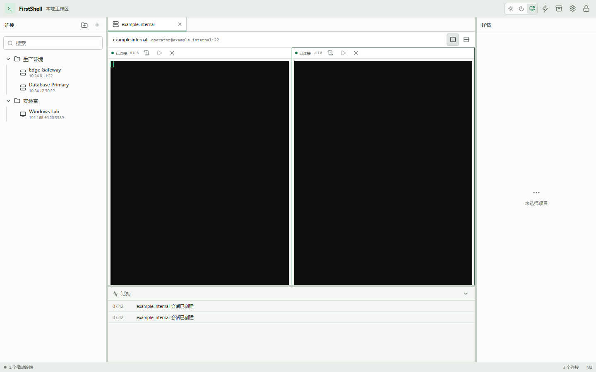
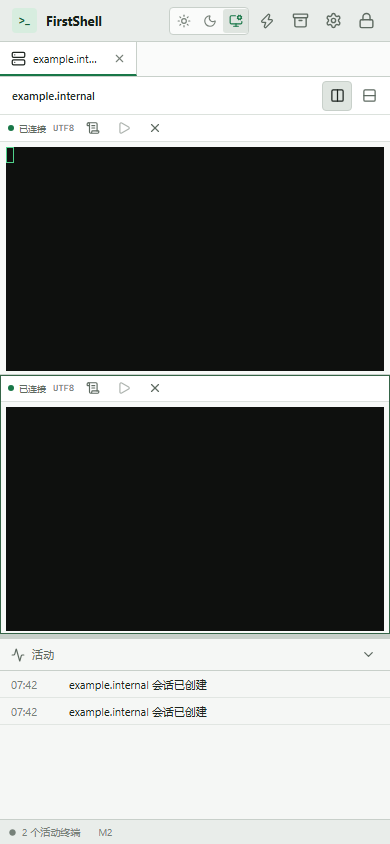
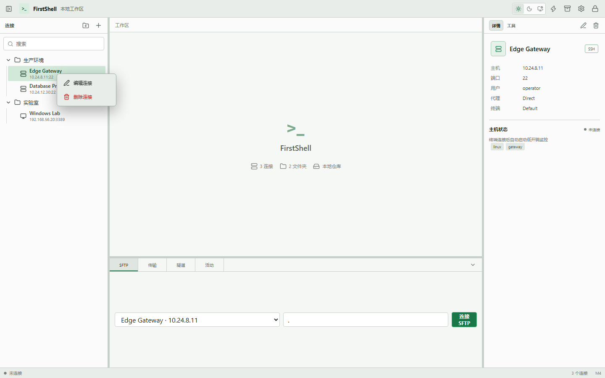
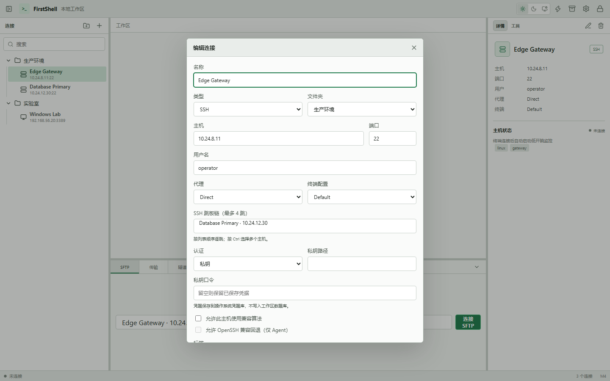

# M2 验收记录

- 验收日期：2026-08-24
- 基线提交：`925bad8`
- 参考平台：Windows，Rust 1.89.0 stable，Node.js 24
- 范围：SSH 认证与信任、会话 actor、本地 PTY、Tauri IPC、xterm 工作台、日志与兼容回退

## 验收结论

M2 的功能、自动化、安全、许可证和文档门槛已通过。用户可以从保存连接或临时快速连接打开 SSH 终端，使用多标签与最多四分屏；Rust 侧负责认证、TOFU、会话生命周期和日志策略，WebView 仅在专用局部表单中短暂持有 SSH 秘密。10 个并发会话、Windows ConPTY、恶意 banner、连接中断、host key 变化和认证失败均有自动化证据。

## 交付证据

| 编号 | 范围 | 已验证行为 | 结果 |
| --- | --- | --- | --- |
| E-001 | 会话运行时 | 32 会话上限、有界队列、10 个活跃会话、64 KiB 输入限制、尺寸限制、显式重连不重放 | 通过 |
| E-002 | Windows 本地 PTY | 白名单 shell、受控环境、ConPTY CPR 往返、关闭无死锁、读写/resize 脱敏错误 | 通过 |
| E-003 | SSH 信任与认证 | TOFU、known_hosts、密钥变化阻断、错误密码、真实密码/私钥/keyboard-interactive 握手 | 通过 |
| E-004 | SSH 防护 | 现代算法默认、单主机旧算法例外、8 KiB banner 清洗、保活、UTF-8/GBK/Big5 | 通过 |
| E-005 | IPC 与秘密 | 主题化专用秘密输入、仅主窗口 IPC、4 KiB 上限、keyring 状态读取后清零、公开 DTO、输出专用日志 sink | 通过 |
| E-006 | 终端工作台 | xterm 动态加载、多标签、多分屏、尺寸同步、TOFU、显式重连、StrictMode 迟到会话关闭 | 通过 |
| E-007 | 供应链 | 完整 Cargo/npm 许可证树；`npm audit` 0 漏洞 | 通过，Rust 公告扫描限制见下文 |

## 可重复门禁

```powershell
cargo fmt --all -- --check
cargo clippy --workspace --all-targets --all-features --locked -- -D warnings
cargo test --workspace --all-targets --all-features --locked
npm --prefix apps/desktop test
npm --prefix apps/desktop run build
npm --prefix apps/desktop run tauri build
node scripts/check-licenses.mjs
$env:HTTPS_PROXY='socks5://127.0.0.1:7890'
$env:HTTP_PROXY='socks5://127.0.0.1:7890'
$env:ALL_PROXY='socks5://127.0.0.1:7890'
npm --prefix apps/desktop audit
git diff --check
```

本次结果：Rust 46 项通过、1 项 M0 release 基准按设计忽略；Vitest 10 项通过；生产前端构建通过，主入口 253.15 KiB，终端动态 chunk 342.37 KiB；release 构建生成 `target/release/firstshell-desktop.exe` 与 `target/release/bundle/nsis/FirstShell_0.1.0_x64-setup.exe`；许可证门禁覆盖 623 个 Cargo package 和 167 个 npm package；npm 公告扫描为 0 个漏洞。

## 安全证据链

| Finding | Evidence | Path | 结论 |
| --- | --- | --- | --- |
| F-001 SSH 身份必须在认证前确认 | E-003、E-004 | 连接请求 → `StrictClientHandler` → app-owned known_hosts → TOFU/变化阻断 → 认证 | 未知 key 只生成公开证据，变化 key 和认证失败均 fail-closed |
| F-002 秘密不能进入前端持久状态、普通业务 DTO、argv 或输入日志 | E-005 | 专用局部密码框 → 授权 IPC → keyring/可清零认证值 → `russh`；OpenSSH 仅 agent 参数；日志只分流 `Output` | 提交后立即清空局部输入；Debug、错误与 argv 不含密码或口令 |
| F-003 会话资源必须有界且断线语义明确 | E-001、E-002 | Tauri command → registry → actor → bounded transport → Channel → xterm | 超限在 Rust 边界拒绝，断线不重放，关闭可回收 |
| F-004 前端异步生命周期不能泄漏 Rust session | E-006 | React generation → async open → stale close/current bind → cleanup close | StrictMode 回归只保留当前活动记录和 session |

会话日志的“只记录输出”不能保证日志不含任何秘密：远端主动回显或用户主动显示的内容仍属于输出。为此日志默认关闭，路径固定在应用数据目录，并执行 7 天保留策略。

## 视觉基线

Playwright 使用无真实凭据的 bridge 场景在 1440×900 和 390×844 视口验收。两种视口均为 2 个 pane、2 条活动记录、0 个日志指示；桌面列分屏在窄屏自动转为纵向，未发现页面溢出、控件重叠或终端空白。

桌面视口：



窄屏视口：



2026-08-24 的凭据 UI 补充回归使用 `scripts/capture-credential-ui.py` 在 1440×900 浅色视口执行真实 React 交互：连接树右键菜单包含编辑与删除两项，宽度 142 px；私钥编辑页显示密码类型的口令输入，弹窗背景为浅色且页面横向溢出为 0。





## 验收边界

- 本机没有安装 `cargo-audit`、OSV Scanner、Trivy、Syft 或 Gitleaks，因此本次没有把 Rust 漏洞公告扫描、SBOM 或独立 secret scanner 写成已通过；完整许可证树、`npm audit` 和人工危险 API/秘密流检查已执行。M7 仍需在 CI 完成 SBOM 与公告门禁。
- 自动化真实握手覆盖密码、未加密 Ed25519 私钥和 keyboard-interactive。私钥口令路径使用同一 `load_secret_key` API，但没有额外生成加密测试 key。
- 回归测试覆盖应用主题凭据弹窗、私钥口令写入 OS keyring 命令，以及快速连接密码只随单次连接请求传递；未在自动化中读取真实生产 keyring 项。
- Windows agent 路径会依次探测 OpenSSH named pipe 与 Pageant；当前验收机未运行可用 agent，因此没有伪造成功认证。无 agent、身份拒绝和算法选择通过稳定脱敏错误及静态/单元路径审查。
- OpenSSH 回退的触发条件、固定参数、host key 文件和禁止认证/host key 错误降级已有单元证据；本次没有准备一台“仅系统 OpenSSH 成功而 russh 连接失败”的外部旧服务器。
- 本次视觉基线运行于浏览器中的同一 React/Vite 资源。项目负责人于 2026-08-24 决定跳过安装后 WebView2 人工流程、窗口管理器和完整冷启动人工验收，这些项目仍未通过并移入 M7。
