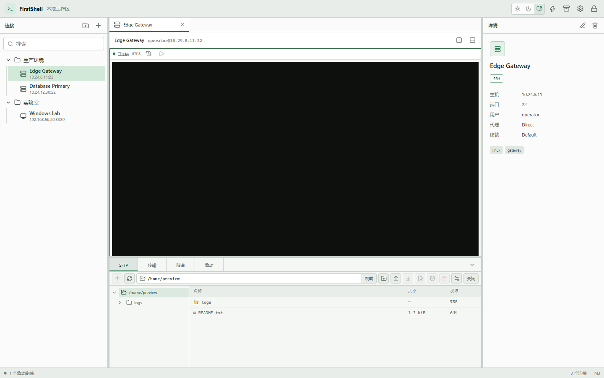
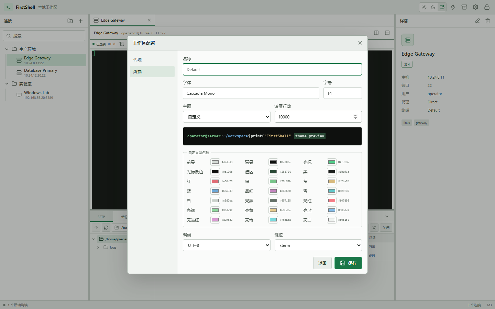
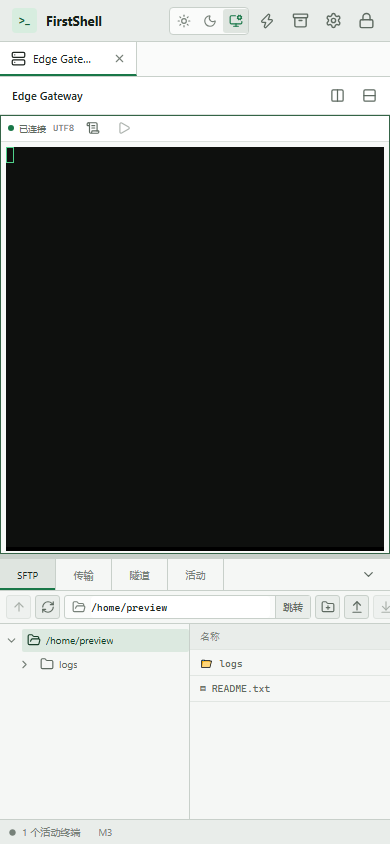

# M3 补充验收记录

- 验收日期：2026-08-24
- 基线提交：`574847b`（M3 已验收提交；本补充为未提交工作区变更）
- 参考平台：Windows，Rust 1.89.0 stable，Node.js 24
- 范围：SSH companion SFTP、紧凑文件工作区、启动快速解锁、终端预设与自定义调色板

## 验收结论

M3 补充的实现、自动化测试、生产前端构建、静态检查、依赖扫描、文档和浏览器视觉基线均通过。持久化 SSH 连接进入 Ready 后自动建立独立的 companion SFTP；同连接的多个终端 pane 共享该 workspace，最后一个 pane 退出后关闭资源。SFTP 失败不改变终端状态，快速连接保持不自动建立 SFTP。

文件工作区改为顶部单行地址/操作栏、左侧懒加载目录树和右侧文件表。地址跳转只接受当前 rooted workspace 内路径，前端先拒绝绝对根外路径和 `..`，Rust SFTP 边界继续执行最终规范化与越界拒绝。Vault 启动时先尝试设备 OS keyring，失败后才显示恢复口令表单，不把失败误报为 Vault 损坏。

终端配置支持 FirstShell、Solarized、Nord、Dracula、Gruvbox、One Dark、High Contrast 预设，以及包含前景、背景、光标、选区和 16 个 ANSI 色的自定义 palette。Rust 仅接受完整的 `#RRGGBB` 值；旧 terminal profile 通过默认字段继续读取，schema version 保持 2。

## 功能与安全证据

| 编号 | 范围 | 已验证行为 | 结果 |
| --- | --- | --- | --- |
| S-001 | Companion 生命周期 | pane Ready 后自动创建、同连接多 pane 共享、最后一个 pane 断开后关闭 | 通过 |
| S-002 | 故障隔离 | SFTP 建立失败不关闭或降级 SSH 终端；快速连接不自动启用 SFTP | 通过 |
| S-003 | 路径导航 | 地址栏可跳转、目录树懒加载、`/etc` 和 `..` 根外跳转拒绝 | 通过 |
| S-004 | 紧凑布局 | 33 px 工具栏、目录树与文件表并列、折叠 Operations 时保持 companion 挂载 | 通过 |
| S-005 | 启动解锁 | 启动优先尝试 OS keyring；失败后稳定回落到恢复口令表单 | 通过 |
| S-006 | 终端主题 | 7 组主题系列、完整自定义 21 色 palette、实时预览并应用到 xterm | 通过 |
| S-007 | 数据兼容 | 旧 profile 缺少 palette 时可读取；自定义主题缺色或非六位十六进制时拒绝 | 通过 |

## 可重复门禁

```powershell
cargo fmt --all -- --check
cargo clippy --workspace --all-targets --all-features --locked -- -D warnings
cargo test --workspace --all-targets --all-features --locked
npm --prefix apps/desktop test
npm --prefix apps/desktop run build
node scripts/check-licenses.mjs
$env:HTTPS_PROXY='socks5://127.0.0.1:7890'
$env:HTTP_PROXY='socks5://127.0.0.1:7890'
$env:ALL_PROXY='socks5://127.0.0.1:7890'
npm --prefix apps/desktop audit
python scripts/capture-m3-supplement-visuals.py
git diff --check
```

本次结果：工作区 Rust 64 项通过、2 项性能基准按设计忽略；Clippy 在全 workspace、全 target、全 feature 且 warnings-as-errors 下通过。Vitest 3 个文件共 17 项通过。生产构建主入口 264.68 KiB，Operations 动态 chunk 23.05 KiB，Terminal 动态 chunk 342.30 KiB。许可证门禁覆盖 623 个 Cargo package 和 167 个 npm package；npm 公告扫描为 0 个漏洞。`git diff --check` 通过，仅输出 Git 的 LF/CRLF 工作区提示。

## 视觉基线

可复现脚本 `scripts/capture-m3-supplement-visuals.py` 使用无真实凭据的 preview bridge，并对关键指标执行断言。1440x900 视口下 `clientWidth=scrollWidth=1440`，地址栏为 `/home/preview`，目录树 2 项、文件表 3 行，SFTP 工具栏高度 33 px；浅色主题的当前根节点背景为 `rgb(220, 233, 224)`，不会回退为深色黑条；方形操作按钮与内部 SVG 的水平中心偏差为 0 px。390x844 视口下 `clientWidth=scrollWidth=390`；Operations 内部内容宽 560 px 并局部滚动，页面本身不产生横向溢出，目录树保持 190 px 可用宽度。主题编辑器完整展示 21 个颜色输入和实时预览。

桌面 SFTP：



终端自定义主题：



窄屏 SFTP：



## 许可证例外与验收边界

- Solarized、Nord、Dracula 和 One Dark 的上游为 MIT；发布 NOTICE 仍须保留相应声明。
- 按项目负责人 2026-08-24 的决定，Gruvbox 在开发阶段作为显式例外保留，不阻塞当前依赖门禁。其许可状态仍为“待确认”，不能据此发布；M7 发布前必须取得明确授权或移除该预设，代码中保留 `TODO(M7 licensing)`。
- 自动快速解锁只在 OS keyring 内已有有效设备密钥时成功；keyring 不可用、条目缺失或密钥无效时回落到恢复口令，不绕过恢复能力。
- 视觉证据运行于浏览器中的同一 React/Vite 资源。安装后 WebView2、真实 SSH/SFTP 服务器、系统 keyring 异常和窗口管理器交互仍属于 M4 后统一实机验收边界。
- 本补充没有改变 SQLite schema、SSH/SFTP 协议或 M3 已记录的传输性能基线，因此不重复执行 M3 Release 吞吐基准。
