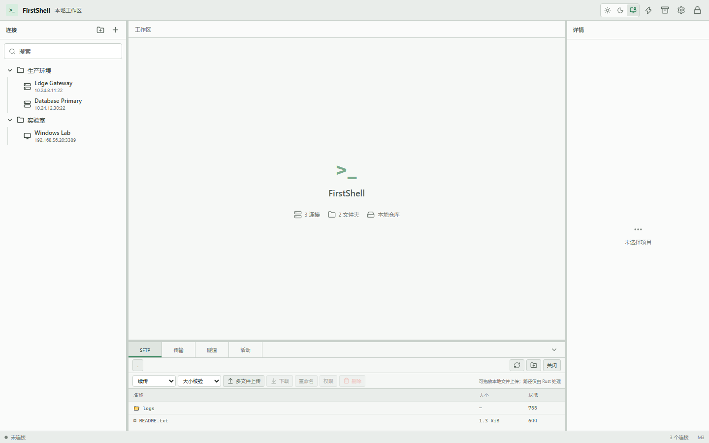
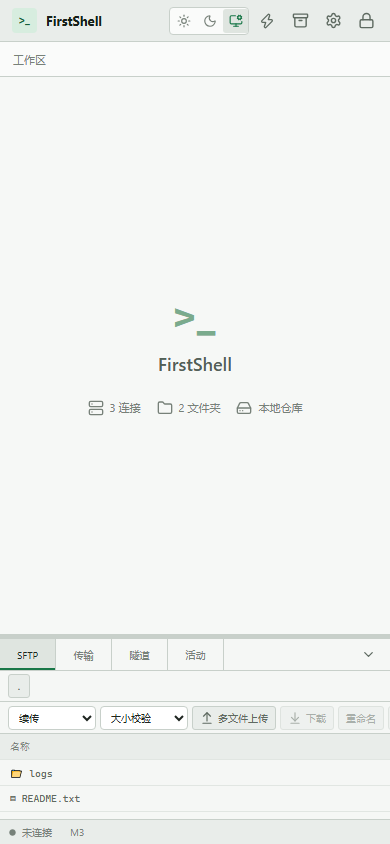

# M3 验收记录

- 验收日期：2026-08-24
- 基线提交：`7fa9fd1`
- 参考平台：Windows，Rust 1.89.0 stable，Node.js 24
- 范围：SFTP、传输队列、拖放、Connector、SSH 跳板链、本地/远程/动态隧道

## 验收结论

M3 的功能、安全、性能、前端自动化和文档门槛已通过。SFTP 工作区提供 rooted 浏览和远程文件操作；上传/下载具备暂停、取消、重试、续传、partial 和大小/SHA-256 校验。Connector 覆盖 Direct、SOCKS5、HTTP CONNECT、系统静态代理和最多四跳 SSH 跳板；隧道覆盖本地、远程和动态 SOCKS5 CONNECT。

本地绝对路径和代理秘密不进入 WebView。传输、隧道和拖放暂存是 Rust 进程内资源，Vault 锁定或 workspace 关闭会统一清理。M4 的远程编辑、压缩传输、ZMODEM、主机监控与效率工具未进入本里程碑。

## 功能证据

| 编号 | 范围 | 已验证行为 | 结果 |
| --- | --- | --- | --- |
| E-001 | Rooted SFTP | canonical root、浏览、mkdir、rename、delete、chmod、路径穿越与符号链接拒绝 | 通过 |
| E-002 | 上传/下载 | 同目录 partial、双向取消和续传、大小/SHA-256、源文件变化检查 | 通过 |
| E-003 | 传输调度 | 256 项上限、2 项并发、进度、重试、generation 防旧回执覆盖、`pausing -> paused -> queued/running`、取消独立状态 | 通过 |
| E-004 | 安全拖放 | Rust DTO 不含绝对路径、目录拒绝、8 批次/64 文件/5 分钟上限、一次性消费 | 通过 |
| E-005 | Connector | Direct、SOCKS5、HTTP CONNECT、认证、本地/远端 DNS、超时、系统静态代理快照 | 通过 |
| E-006 | SSH 跳板链 | 首跳代理、逐跳 `direct-tcpip`、独立认证/host key、四跳上限、传递循环拒绝 | 通过 |
| E-007 | 隧道 | 本地、远程和动态 CONNECT；loopback 默认、非 loopback 确认、128 连接上限、停止清理 | 通过 |
| E-008 | 生命周期 | pending host-key 继续、Vault lock/workspace close 清理、OpenSSH fallback 路由限制 | 通过 |
| E-009 | Operations UI | SFTP、传输、三类隧道、进度和暂停/恢复；Operations 与 Terminal 独立动态 chunk | 通过 |

## Release 性能证据

同一受控本地 SSH/SFTP 服务、同一 64 MiB 输入文件和 Release 构建下：

| 指标 | 结果 | 门槛 |
| --- | ---: | ---: |
| Windows OpenSSH `sftp.exe` 上传 + 下载 | 2050 ms | 基线 |
| FirstShell 产品 SFTP 上传 + 下载 | 821 ms | 不低于基线 85% |
| 吞吐比 `OpenSSH / FirstShell` | 2.496 | >= 0.85 |
| 10 终端 + 2 个并行 64 MiB 上传 p95 | 789 us | < 1 s |
| 最大终端响应 | 789 us | < 1 s |
| 输入丢失 | 0 | 0 |

重放命令：

```powershell
cargo test --release -p firstshell-ssh --test russh_spike m3_release_sftp_throughput_and_terminal_fairness -- --ignored --nocapture
```

该基准仅用于本机相同 fixture 的相对比较，不代表公网服务器、磁盘或网络的绝对吞吐承诺。

## 可重复门禁

```powershell
cargo fmt --all -- --check
cargo clippy --workspace --all-targets --all-features --locked -- -D warnings
cargo test --workspace --all-targets --all-features --locked
npm --prefix apps/desktop test
npm --prefix apps/desktop run build
npm --prefix apps/desktop run tauri build
node scripts/check-licenses.mjs
$env:HTTPS_PROXY='socks5://127.0.0.1:7890'
$env:HTTP_PROXY='socks5://127.0.0.1:7890'
$env:ALL_PROXY='socks5://127.0.0.1:7890'
npm --prefix apps/desktop audit
git diff --check
```

本次结果：工作区 Rust 62 项通过、2 项基准按设计忽略；M3 Release 性能基准另行显式运行 1 项并通过。Vitest 3 个文件共 14 项通过；生产构建主入口 258.35 KiB、Operations 动态 chunk 17.16 KiB、Terminal 动态 chunk 342.38 KiB。许可证门禁覆盖 623 个 Cargo package 和 167 个 npm package，npm 公告扫描为 0 个漏洞。release 构建生成 23,192,064 字节的 `target/release/firstshell-desktop.exe` 和 5,555,076 字节的 `target/release/bundle/nsis/FirstShell_0.1.0_x64-setup.exe`。

## 安全证据链

| Finding | Evidence | Path | 结论 |
| --- | --- | --- | --- |
| F-001 远程路径不能逃逸 SFTP root 或隐式跟随链接 | E-001、E-002 | relative path -> parent `lstat`/canonicalize -> rooted operation -> partial/校验 | `..`、绝对路径和 symlink traversal 均 fail-closed |
| F-002 网络路由不能绕过认证与逐跳信任 | E-005、E-006、E-008 | proxy keyring -> first-hop Connector -> per-hop direct-tcpip -> host/port/fingerprint approval | 代理/跳板禁用 fallback，循环、深度和未知 key 在 Rust 边界拒绝 |
| F-003 本地路径与代理秘密不能进入 WebView | E-004、E-005、E-009 | native dialog/drop/keyring -> Rust registry -> opaque ID/public snapshot -> Operations UI | DTO 仅含批次 ID、名称、大小和公开进度 |
| F-004 传输与隧道资源必须有界并可回收 | E-003、E-007、E-008 | Tauri command -> bounded registry/semaphore -> cancellation generation -> SSH cleanup | 暂停与取消状态独立，Vault/workspace close 取消并清空资源 |
| F-005 非 loopback 转发必须是显式风险选择 | E-007 | tunnel form confirmation -> Rust bind validation -> bounded listener -> stop/cancel | 默认 loopback，未确认的外部暴露 fail-closed |

## 视觉基线

可复现脚本 `scripts/capture-m3-visuals.py` 使用无真实凭据的 preview bridge，在 1440x900 与 390x844 视口捕获相同 React/Vite 资源。桌面页面没有横向溢出；窄视口没有全局横向溢出，SFTP 高密度工具栏只在 Operations 面板内部滚动。

桌面视口：



窄屏视口：



## 验收边界

- `russh-sftp 2.4` 没有 OpenSSH `posix-rename` 扩展封装。新目标使用同目录 rename；覆盖既有远程文件需要先 remove 再 rename，存在极短替换窗口，不能视为严格原子覆盖。
- 系统代理只读取连接开始时的静态设置并固化结果；PAC URL、PAC JavaScript 下载和执行不在 M3 范围。
- 视觉证据运行于浏览器中的同一 React/Vite 资源。安装后 WebView2、窗口管理器和真实远端设备的统一人工验收仍按项目决定在 M4 后执行。
- 本机没有安装 Rust 公告扫描、SBOM 或独立 secret scanner 工具；许可证树、`npm audit`、自动化安全路径和代码审查不能替代这些 M7 门禁。
- 传输、隧道和拖放批次是进程内状态，应用退出后不恢复；本地绝对路径、partial 名和代理秘密不持久化。
