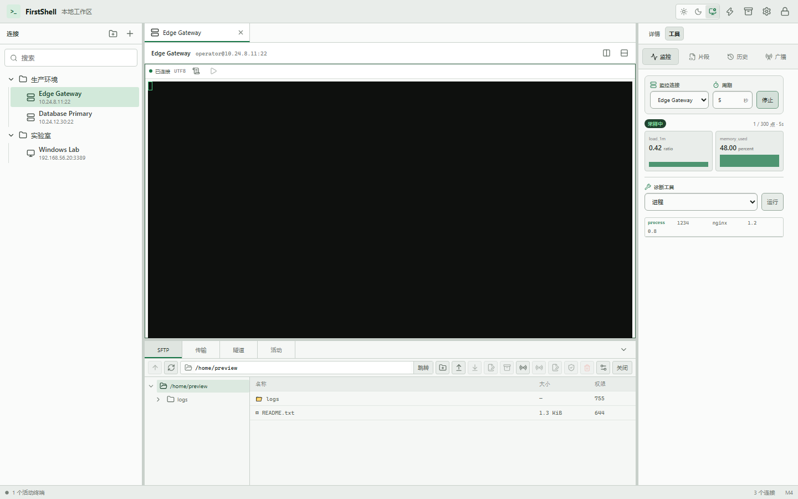
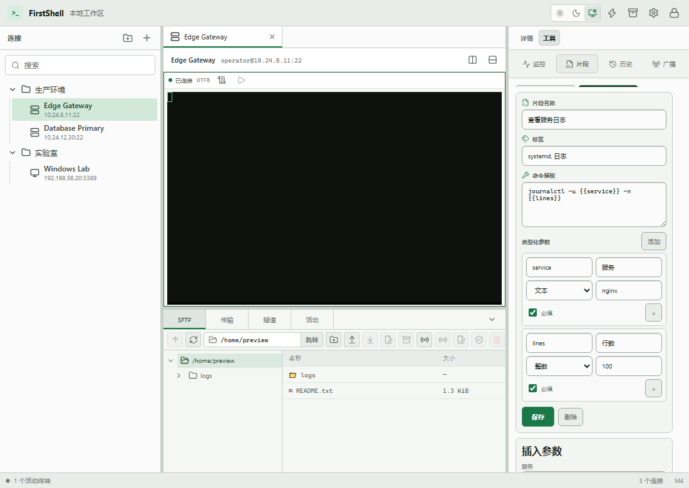

# M4 验收记录

- 验收日期：2026-08-24
- 基线提交：`179aa3b`
- 参考平台：Windows，Rust 1.89.0 stable，Node.js 24
- 范围：agentless 监控、加密片段与历史、命令广播、远程编辑、受控压缩和 ZMODEM

## 验收结论

M4 的实现、自动化测试、安全边界、生产前端、许可证、浏览器视觉基线和 Windows 生产打包通过。监控使用独立 SSH 连接和有界环形缓冲；片段与历史使用 schema 3 的 Vault 密文记录；广播在 Rust registry 中先校验完整目标集合再统一投递；远程编辑、压缩和 ZMODEM 继续受 rooted SFTP 与有界传输队列约束。

项目负责人于 2026-08-24 明确决定跳过本轮实机测试并保存文档。因此安装包安装后人工流程、真实外部 SSH/SFTP、真实 lrzsz 互操作、多显示器和窗口人工检查均为“未执行”，不是“通过”；这些风险移入 M7 发布验收。M4 `Complete` 表示本里程碑实现和自动化门槛完成，不改变该延期结论。

## 功能与资源证据

| 编号 | 范围 | 已验证行为 | 结果 |
| --- | --- | --- | --- |
| E-001 | Agentless 探针 | host/process/port/ping/traceroute 固定模板，8 秒超时，512 KiB 输出，schema 1 解析与控制字符清洗 | 通过 |
| E-002 | 监控生命周期 | 最多 16 个监控、2–60 秒周期、300 点 `VecDeque`、1–300 点降采样、三次失败降级并可恢复 | 通过 |
| E-003 | 加密效率对象 | schema 3 `snippets`/`efficiency_state` 密文表、严格 revision、500 项命令/路径历史、锁定后恢复 | 通过 |
| E-004 | 参数化片段 | text/integer/choice/host/path 五类参数、placeholder 完整匹配、注入拒绝、默认只插入不发送回车 | 通过 |
| E-005 | 命令历史与广播 | Enter 才记录、控制序列忽略、最多 16 个显式 session、缺失/重复目标无部分投递、Ctrl-C 紧急停止 | 通过 |
| E-006 | 远程编辑与压缩 | 2 MiB UTF-8、NUL/symlink 拒绝、打开与替换前双指纹、外部修改冲突、固定 tar 模板和 shell quoting | 通过 |
| E-007 | ZMODEM | `zmodem2 0.7.2` caller-owned 状态机、`rz --protect`/`sz --`、4 GiB/10 分钟上限、256 项/2 并发队列、内存往返 | 自动化通过；真实 lrzsz 延期 |
| E-008 | 前端生命周期 | Tools 首次按需加载后常驻，详情切换只隐藏；同毫秒插入使用单调序号；Terminal/Tools/Operations 独立 chunk | 通过 |

监控不会复用交互终端 channel：每个监控持有独立认证连接，并在 desktop tools registry 中单独取消。长期资源证据是受上限保护的模拟采样回归，证明持续 push 后仍为 300 点；本轮没有执行 8 小时真实远端 soak，M7 仍需补充进程 RSS 与网络故障注入。

## 可重复门禁

```powershell
cargo fmt --all -- --check
cargo clippy --workspace --all-targets --all-features --locked -- -D warnings
cargo test --workspace --all-targets --all-features --locked
npm --prefix apps/desktop test
npm --prefix apps/desktop run build
node scripts/check-licenses.mjs
$env:HTTPS_PROXY='socks5://127.0.0.1:7890'
$env:HTTP_PROXY='socks5://127.0.0.1:7890'
$env:ALL_PROXY='socks5://127.0.0.1:7890'
npm --prefix apps/desktop audit
python scripts/capture-m4-visuals.py
npm --prefix apps/desktop run tauri build
git diff --check
```

最终结果：工作区 Rust 73 项通过、2 项既有 release 基准按设计忽略；Vitest 4 个文件共 24 项通过。生产构建主入口 262.51 KiB，Tools 14.54 KiB、Operations 26.63 KiB、Terminal 343.17 KiB，三个工作区保持独立动态分块。许可证门禁覆盖 624 个 Cargo package 和 167 个 npm package；npm 公告扫描为 0 个漏洞。Tauri release/NSIS 构建生成 `target/release/firstshell-desktop.exe` 与 `target/release/bundle/nsis/FirstShell_0.1.0_x64-setup.exe`。

## 安全证据链

| Finding | Evidence | Path | 结论 |
| --- | --- | --- | --- |
| F-001 WebView 不能获得通用远程命令能力 | E-001、E-006 | typed probe/archive request → Rust validation → fixed template → bounded SSH output | target、路径和 shell word 在 Rust 边界验证，无通用 shell Tauri API |
| F-002 片段与历史不能成为明文秘密旁路 | E-003、E-004 | UI input → typed application service → Vault record AEAD → schema 3 storage | 名称、标签、模板、参数和历史正文均在密文 payload 内，锁定后清理 |
| F-003 广播验证失败不能产生部分副作用 | E-005 | confirmed target IDs → registry lock → target/capacity preflight → all `try_send` | 空、重复、缺失和背压目标在任何投递前失败 |
| F-004 远程文件工具不能绕过 rooted SFTP | E-006、E-007 | opaque workspace ID → rooted path validation → bounded operation → conflict/partial/rename | 路径穿越、symlink、外部修改和 advertised filename 不匹配均失败关闭 |
| F-005 后台工具不能无限占用内存或连接 | E-002、E-007 | desktop registries → fixed item/concurrency limits → cancellation → Vault lock cleanup | 监控、传输、session 和历史均有明确上限与统一清理路径 |

## 视觉基线

可复现脚本 `scripts/capture-m4-visuals.py` 使用无真实凭据的 preview bridge，并执行真实 React 状态切换。1440x900 视口中页面 `clientWidth=scrollWidth=1440`，监控显示 2 张指标卡、1 行进程结果、4 个工具标签和 `1 / 300 点 · 5s`；脚本切换“工具 → 详情 → 工具”后同一监控状态仍保留。

桌面监控：



1100x780 窄视口中页面 `clientWidth=scrollWidth=1100`，右栏宽 288 px，片段页包含新建入口、既有片段、2 个类型化参数编辑行和 2 个运行参数输入，未出现全局横向溢出。

窄视口片段：



## Windows 生产产物的有限观察

在用户要求停止实机测试前，release EXE 曾成功创建唯一标题为 `FirstShell` 的真实窗口；UI Automation 可读取 WebView2 `RootWebArea`，并识别连接树、终端区、Operations、“详情/工具”切换和页脚 `M4`。Windows Graphics Capture 再次返回 `SetIsBorderRequired ... 0x80004002`，因此没有生成安装后窗口截图，也没有继续点击真实 Vault 数据。

同一登录会话内曾记录 5 次 release EXE 从进程启动到首个窗口句柄的有限样本：61.38–133.57 ms，均值 80.23 ms，p95/max 133.57 ms。这不是重启系统后的安装包冷启动、WebView 首次安装或人工可交互完成时间，不能替代延期的发布验收。

## 明确跳过并延期到 M7

| 项目 | 本轮状态 | 残余风险 |
| --- | --- | --- |
| NSIS 实际安装、升级、卸载与安装后首次启动 | 未执行 | 安装权限、WebView2 引导、升级/回滚和数据保留未验证 |
| 初始化、锁定、恢复口令、CRUD、浅/深色人工流程 | 未执行 | 焦点、系统对话框、真实 Vault 状态转换和视觉细节未人工确认 |
| 多显示器、DPI 缩放、窗口最小尺寸 | 未执行 | 窗口管理器和缩放边界仅有浏览器布局证据 |
| 真实外部 SSH/SFTP、keyring 异常恢复 | 未执行 | 网络、服务器实现、平台 agent/keyring 异常组合仍可能暴露兼容问题 |
| 真实 `rz`/`sz` 与 lrzsz 互操作 | 未执行 | 不同 lrzsz 版本、终端环境、文件名与中断恢复仍需实机验证 |
| 8 小时监控/传输 soak 与进程 RSS | 未执行 | 自动环形缓冲证明上限，但不能证明完整进程无其他长期增长 |

M7 发布检查必须重新列出这些项目，不能因 M4 状态为 `Complete` 而自动继承“通过”。
