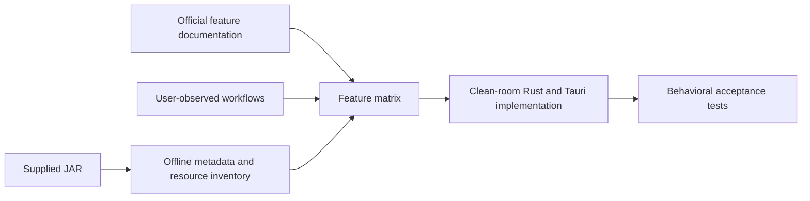

# FinalShell reference summary

The supplied JAR is a strongly obfuscated Java desktop application. Static analysis confirms a dense Swing-style workstation, a large theme/font inventory, proxy configuration, command-history behavior, path autocomplete, an editor surface, and bundled networking/system-inspection libraries. It does not provide a trustworthy product version or a maintainable source-level specification.

For FirstShell, treat the JAR as a behavioral reference only. The acceptance baseline should combine the supplied sample's observable UI with the current official feature list: multi-tab SSH, SFTP in the same workspace, resource and process monitoring, proxy and tunnel support, command history/completion, command snippets with parameters, text editing, packed transfer, ZMODEM, remote desktop integration, encrypted sync, and optional acceleration.

The exact compatibility matrix remains a product artifact to be approved before implementation. Proprietary acceleration requires a separate relay/service design and cannot be delivered by a desktop-only SSH client.

